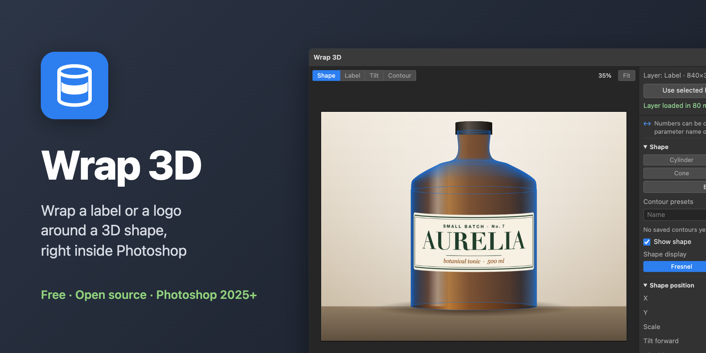
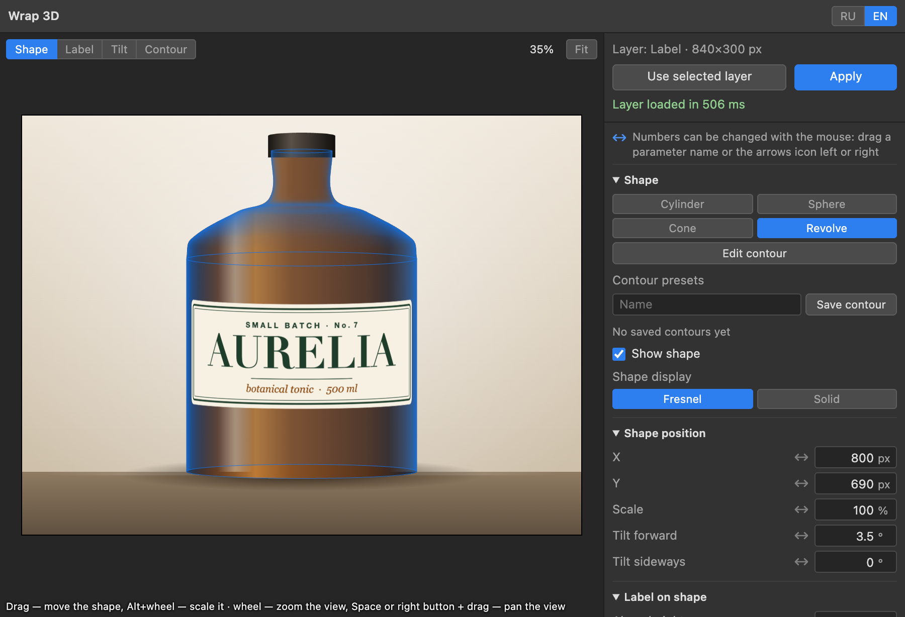
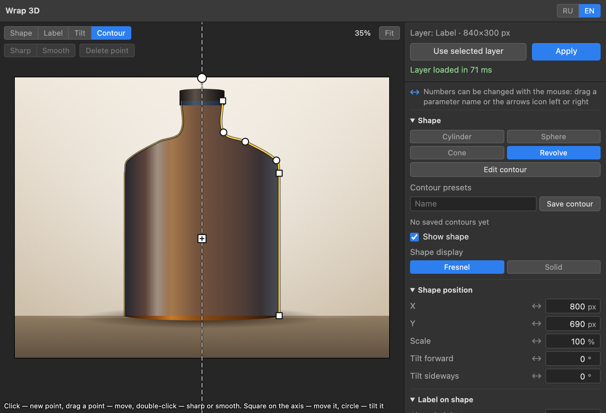
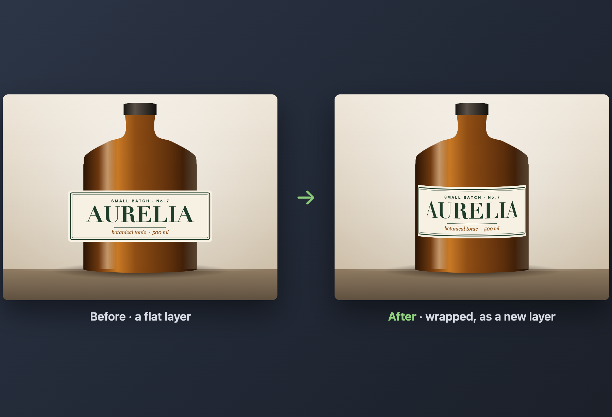

# Wrap 3D

[](https://github.com/Toys-D/Wrap3D/releases/latest)


[](LICENSE)

A Photoshop plugin that wraps a label or a logo around a 3D shape and puts the result back into the document as a layer. Photoshop's own 3D layers are gone, and **Edit ▸ Transform ▸ Warp ▸ Cylinder** gives you very little to work with. Wrap 3D gives you a real form to match against the photo: a cylinder, a sphere, a cone, or a body of revolution you draw yourself.

**[Download the latest release](https://github.com/Toys-D/Wrap3D/releases/latest)** · Photoshop 2025 (26.0) or newer · free and open source





| | |
|:---:|:---:|
|  |  |
| **The contour editor:** trace half of the silhouette, the plugin revolves it | **The result:** a new layer, exactly in place, on a transparent background |

## What it does

- **Any layer as the source.** Text, a logo, a smart object: the selected layer is taken with its transparency.
- **Four shapes.** Cylinder, sphere, truncated cone, and a body of revolution built from a contour you draw.
- **A contour editor.** Half of the profile over a snapshot of your document. Add, move and delete points, switch each one between sharp and smooth, move and tilt the axis to follow the bottle in the photo. Contours are saved as presets.
- **Placement on the shape.** Position along the height, rotation around the axis, scale, wrap angle. The part of the label that goes behind the shape is hidden, with a switch to show it.
- **Matching the photo.** The document shows through the viewport. Move, scale and tilt the shape; choose an orthographic or a perspective camera and its field of view. Every parameter has a number field, and every number can be dragged with the mouse.
- **Honest colours.** No shading by default: the pixels of your layer pass through unchanged. Soft shading toward the edges of the shape is optional.
- **Back into the document.** Rendered at document resolution on a transparent background and placed as a new layer exactly where it belongs, in a single history step. The shape itself never gets into the result. Large documents render only the label area, in tiles when it exceeds the WebGL limits.
- **Picks up where you left off.** The scene of the last Apply is restored when you open the panel again.
- **Languages.** English and Russian. The panel follows Photoshop's language; switch it with **RU / EN** in the panel header.
- **Stays offline.** three.js is bundled with the plugin. Nothing is loaded from the network.

## Install

The plugin is not on the Adobe Marketplace, so it is loaded through Adobe's UXP Developer Tools.

1. Download `Wrap3D-…zip` from the [releases page](https://github.com/Toys-D/Wrap3D/releases/latest) and unpack it.
2. In Photoshop open **Preferences ▸ Plugins**, turn on **Enable Developer Mode** and restart Photoshop.
3. Install **UXP Developer Tools** from the Creative Cloud app and open it.
4. Press **Add Plugin**, pick `manifest.json` from the unpacked folder, then **••• ▸ Load**.

The panel opens from **Plugins ▸ Wrap 3D**.

## How to use it

1. Select the layer with the label and press **Use selected layer**.
2. Pick a shape and match it to the object in the photo: drag it in the viewport, or set the numbers on the right.
3. Switch the mouse mode to **Label** to turn the label around the axis and move it along the height.
4. Press **Apply**. The wrapped label appears as a new layer above the original.

## Good to know

- Works with **RGB** documents. Tested on 8-bit documents in Photoshop 26.2 on macOS (Apple Silicon). Nothing in the code is tied to the Mac, but Windows has not been tested yet.
- The contour editor is flat: trace the silhouette as you see it, then adjust the tilt and the camera in 3D.
- The result area is limited to 64 megapixels.

## Build from source

Requires Node.js 20 or newer.

```bash
npm install
npm run build
npm test
```

`plugin/` is the folder Photoshop loads. The interface lives in `webview-src/` and is bundled together with three.js into `plugin/webview/app.js`. The bundle is committed, so the repository works right after cloning.

A release archive: `npm run package`, the result lands in `dist/`.

### Under the hood

- **The UXP side is thin.** It reads layer pixels and writes the result through Photoshop's Imaging API, and keeps settings and presets in the plugin's data folder.
- **The interface and the 3D render live in a WebView** with local HTML, drawn with three.js. The scene is measured in document pixels, so any rectangle of the document can be rendered one to one.
- **Pixels travel as base64 strings** over `postMessage`, in chunks: the bridge between UXP and a WebView carries JSON only. Sixteen megabytes take about 50–200 ms.

## Support the project

Wrap 3D is free and open source. I build it alone, in my spare time. If it saves you time, support it: that is what lets me spend more of mine on it.

**[Support via PayPal](https://www.paypal.com/cgi-bin/webscr?cmd=_xclick&business=pixmap1981%40gmail.com&item_name=Wrap+3D&currency_code=USD)** · Support is voluntary; nothing in the plugin depends on it.

## Get in touch

Bugs, questions, wishes: **[pixmap1981@gmail.com](mailto:pixmap1981@gmail.com?subject=Wrap%203D)**, or open an [issue](https://github.com/Toys-D/Wrap3D/issues).

## License

Copyright © 2026 Pixmap Labs.

GNU GPL v3, see [LICENSE](LICENSE). The plugin bundles [three.js](https://threejs.org) (MIT); its licence notice is kept inside `plugin/webview/app.js`.

---

## По-русски

Плагин для Photoshop, который натягивает надпись или логотип на 3D-форму и возвращает результат в документ слоем. Встроенных 3D-слоёв в Photoshop больше нет, а **Редактирование ▸ Трансформирование ▸ Деформация ▸ Цилиндр** даёт слишком мало настроек. Wrap 3D даёт настоящую форму, которую можно совместить с фото: цилиндр, сферу, конус или тело вращения по своему контуру.

**[Скачать последнюю версию](https://github.com/Toys-D/Wrap3D/releases/latest)** · Photoshop 2025 (26.0) и новее · бесплатно и с открытым кодом.

Источник — выделенный слой с прозрачностью: текст, логотип, смарт-объект. Четыре формы: цилиндр, сфера, усечённый конус, тело вращения. Редактор контура поверх снимка документа: точки можно добавлять, двигать, удалять и делать острыми или сглаженными, ось — сдвигать и наклонять под бутылку на фото; контуры сохраняются как пресеты. Надпись двигается по высоте и вокруг оси, меняет масштаб и угол охвата; часть, уходящая назад, скрывается. Форму можно двигать, масштабировать и наклонять, камера ортогональная или перспективная с углом обзора; у каждого параметра есть числовое поле, и каждое число можно тянуть мышью. По умолчанию без затенения, цвета надписи не меняются; мягкое затенение к краям включается отдельно. Результат рендерится в разрешении документа на прозрачном фоне и вставляется новым слоем точно на своё место одной записью в истории. При следующем открытии панели сцена последнего применения восстанавливается.

**Языки:** русский и английский. Панель берёт язык Photoshop, переключить можно кнопками **RU / EN** в её шапке.

**Установка.** Плагина нет в Adobe Marketplace, поэтому он загружается через UXP Developer Tools. Скачайте архив со [страницы релизов](https://github.com/Toys-D/Wrap3D/releases/latest) и распакуйте. В Photoshop откройте **Настройки ▸ Внешние модули**, включите **«Включить режим разработчика»** и перезапустите Photoshop. Установите **UXP Developer Tools** из приложения Creative Cloud, нажмите **Add Plugin**, выберите `manifest.json` из распакованной папки, затем **••• ▸ Load**. Панель открывается из меню **Подключаемые модули ▸ Wrap 3D**.

**Как пользоваться.** Выделите слой с надписью и нажмите «Взять выделенный слой». Выберите форму и совместите её с предметом на фото — мышью во вьюпорте или числами справа. В режиме «Надпись» поверните надпись вокруг оси и подвиньте по высоте. Нажмите «Применить»: надпись появится новым слоем над исходным.

**Важно знать.** Работает с RGB-документами. Проверен на 8-битных документах в Photoshop 26.2 на macOS (Apple Silicon); к Mac код не привязан, но на Windows пока не проверялся. Область результата — до 64 мегапикселей.

**Сборка из исходников:** Node.js 20+, затем `npm install`, `npm run build`, `npm test`. Архив для релиза: `npm run package`.

**Поддержать.** Плагин бесплатный и с открытым кодом, я делаю его один, в свободное время. Если он экономит вам время, **[поддержите через PayPal](https://www.paypal.com/cgi-bin/webscr?cmd=_xclick&business=pixmap1981%40gmail.com&item_name=Wrap+3D&currency_code=USD)**. Поддержка добровольная, ничего в плагине от неё не зависит.

**Связь.** Ошибки, вопросы, пожелания: **[pixmap1981@gmail.com](mailto:pixmap1981@gmail.com?subject=Wrap%203D)** или [issue на GitHub](https://github.com/Toys-D/Wrap3D/issues).

**Лицензия:** © 2026 Pixmap Labs, GNU GPL v3. В плагин встроен three.js (MIT).
